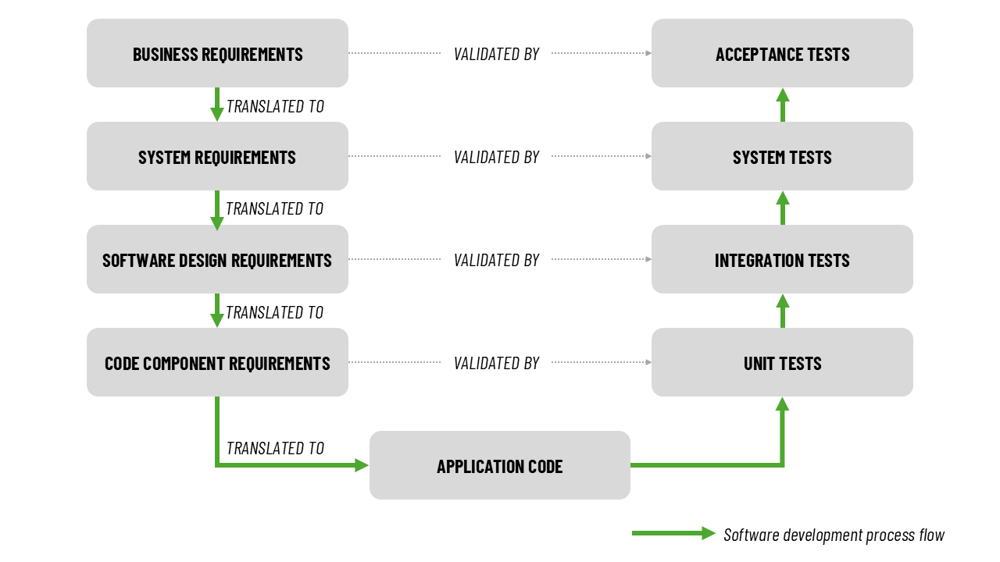

<h1>
  Java Test-Driven Development
  Levels of Testing
</h1>

**Learning objective:** By the end of this lesson, you will be able to describe the software testing process and its levels.

## An introduction to software testing

In a traditional waterfall model of the software development lifecycle (SDLC), **software testing phase** starts once the application coding (Development phase) is completed. Software testing is an activity performed to identify errors so that they can be removed before the software is deployed to the users. It ensures that the product meets specified requirements, in turn, ensuring the quality, reliability, and functionality of a software product. Testing is a critical activity that reduces the risk of costly post-deployment failures.

## Levels of testing

### Level 1: Unit testing
Unit tests are conducted immediately after the coding is completed. Every individual functional component of code (methods, in case of Java) is tested against the coding requirements. Unit tests identifies and fixes bugs in the code within each method, thus ensuring the method as a whole is working as required. Unit testing is usually performed by developers.

### Level 2: Integration testing
Integration tests are conducted after successful completion of unit tests. Once unit tests confirm that individual components are working as expected, the next logical step is to test the interaction between those components (Interfaces). Integration tests identifies and fixes bugs in the component interfaces (method calls those fail). It is usually carried out by anybody who has a high level view of how different components of the application interact with each other to realise the rquired application behaviours. It could be developers, technical designers or software architects.

### Level 3: System testing
System tests are conducted after successful completion of integration tests. While unit tests and integration tests are **white box** tests (code and its execution flow is visible to the tester), system tests are performed as **black box** tests (Testers interact with the user interface to perform the test. Code is invisible to them). System tests are performed from an end-user perspective, to identify bugs in the application functionality. System tests are carried out by professional software testers and/or technical analysts.

### Level 4: Acceptance testing
Acceptance tests are conducted after successful completion of system tests. They are performed by clients or the actual end-users to ensure what they asked in the first place, in other words, their business needs are satisfied by the software. 

## Software Testing Lifecycle (STLC)
Just like software development life cycle has its phases, each level of testing that we saw just now also has its phases.

### Requirements gathering phase
The activities in this phase are:
- Getting a clear understanding of every stated requirement.
- Seeking clarifications, if necessary
- Documenting the requirements in a **Requirements Traceability matrix** (RTM) which will be used in each of the following phases to ensure that no requirement remains unaddressed.

### Test planning and preparation phase
The activities in this phase are:
- Creating test cases and documenting them in a **Test Case Document** (TCD)
- Ensuring each test case is mapping to a requirement in the RTM. Eliminating test cases that dont. 
- Ensuring that each requirement is covered 100 percent by the presence of test cases all possible scenarios. If gaps are identified, adding test cases to cover them.

### Test execution phase
Once there is an official confirmation that code development is complete (for unit tests) and the tests in the prior levels have satisfactorily passed (for integration, system and acceptance testing levels):
- Execute the test cases
- For the test case that pass, mark them so in the TCD.
- For test cases that fail, mark them so in the TCD and log a defect.
- Once the developer reports that a defect has been fixed:
  - execute the failed test cases to make sure they are passing (Retest).
  - execute the already passed test cases to ensure that they are still passing and the defect fix didn't break any working-requirement (Regression test).

### Test closure phase
The activities in this phase are:
- Preparing a test report that contains:
  - Test coverage (number of tests cases out of total tests cases executed)
  - If coverage is less than 100 percent, then reason for the same.
  - Defects found and fixed.
  - Unfixed defects, if any.
  - Reasons for not fixing the defects and their risk.
- Forwarding the test report to the person/team responsible for the next phase, indicating the end of testing.