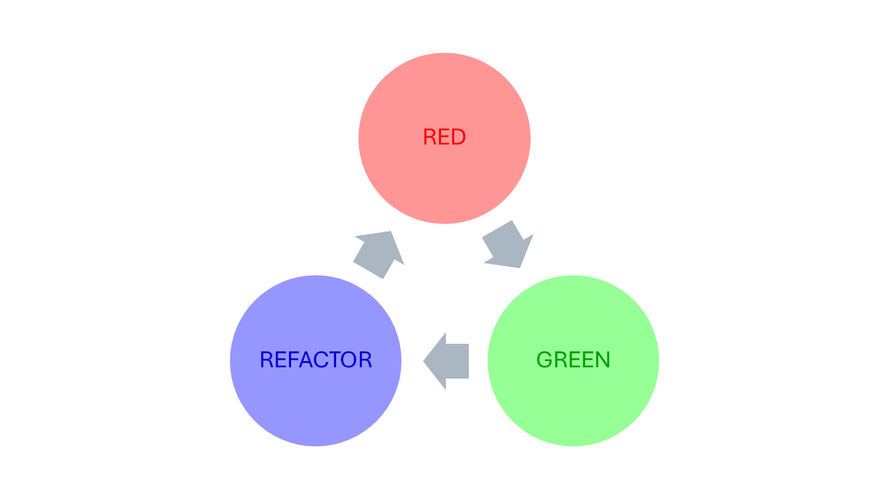

<h1>
  Java Test-Driven Development
  What is Test-Driven Development?
</h1>

**Learning objective:** By the end of this lesson, you'll be able to:
- Define Test-Driven Develompent (TDD) methodology and explain its process flow.
- List TDD's advantages over traditional testing methodology
- Describe how TDD supports Agile development processes.

## What is Test-Driven development (TDD)?
While traditional software development methodologies work on the principle of *Code first and then test*, Test-Driven Development methodology inverts this principle as *Test first and then you'll know what to code*.

|**Aspect**|**Test-Driven Development**|**Traditional Software Development**|
|:---|:---|:---|
|**Definition**|A development methodology where tests are written before writing the actual code.|A development methodology where coding is done first, followed by testing.|
|**Focus**|Emphasis on ensuring functionality meets testable specifications early.|Emphasis on fulfilling requirements in the code and addressing issues later through testing.|
|**Driving Factor**|Driven by the need to pass predefined test cases.|Driven by the need to implement the requirements or features directly.|
|**Approach**|Iterative and incremental; encourages small development cycles.|Sequential and milestone-based; testing is often a separate phase.|
|**Error Detection**|Errors are forced to occur early and, hence, identified early.| Errors are detected only after full code development, during the testing phase.|
|**Code Quality**|Ensures cleaner, modular, and testable code from the start.|Higher risk of code quality degradation over time as fixing issues later may involve patching.|
|**Test Coverage**|Comprehensive, as tests are integral to development.|Risk of partial test coverage exists, subjected to effort overhead from defect identification, fixing and restesting.|
|**Testing technique**|Always automated.|Can be manual or automated.|
|**Learning Curve**|Requires developers' skill building around writing automated test cases and test-driven principles as testing is prioritized over coding.|Easier to start, as coding is prioritized over testing.|

## TDD process
Test-Driven Development follows a three-phase process:

- **Red**: We write a failing test for the specific functionality (method) we’re about to implement. We do this using a unit testing automation framework like JUnit. This test should demonstrate that the desired behavior is not currently present in the code.
- **Green**: We, then, write the minimum amount of code necessary to make the failing test pass. The goal is to achieve a passing test, indicating that the new functionality has been successfully added.
- **Refactor**: Once the test passes, we refactor the code to improve its design and maintainability. This step ensures that the code remains clean and well-structured.

Then the process is iterated for the next functionality, until all the components, as per the requirement,  

## TDD and Agile methodology

|**Agile principle**|**TDD’s role in fulfilling it**|
|:---|:---|
|**Delivering working software frequently.**|TDD ensures each small iteration delivers fully functional and testable software.|
|**Welcoming changing requirements.**|TDD’s robust tests support changes by reducing risks associated with refactoring.|
|**Prioritizing individuals and interactions over processes and tools.**|Test writing involves close collaboration between business people and developers to clarify requirements and expectations.|
|**Prioritizing working software over comprehensive documentation.**| The automated tests serve as living documentation of the system and are always present with the source code. The software is always in a state that can be tested and verified. Each test describes a specific functionality, reducing the need for exhaustive upfront documentation.|
|**Building projects around motivated individuals.**|TDD empowers developers with confidence by providing immediate feedback on code quality.|
|**Simplification**.|TDD eliminates unnecessary coding by focusing only on what is required to pass tests.|
|**Continuous attention to technical excellence.**|TDD promotes clean, modular, and maintainable code.|

TDD comes into its own with **pair programming** approach. One developer can write and execute the unit test, and then allow the other developer to write the code to make the test pass.
